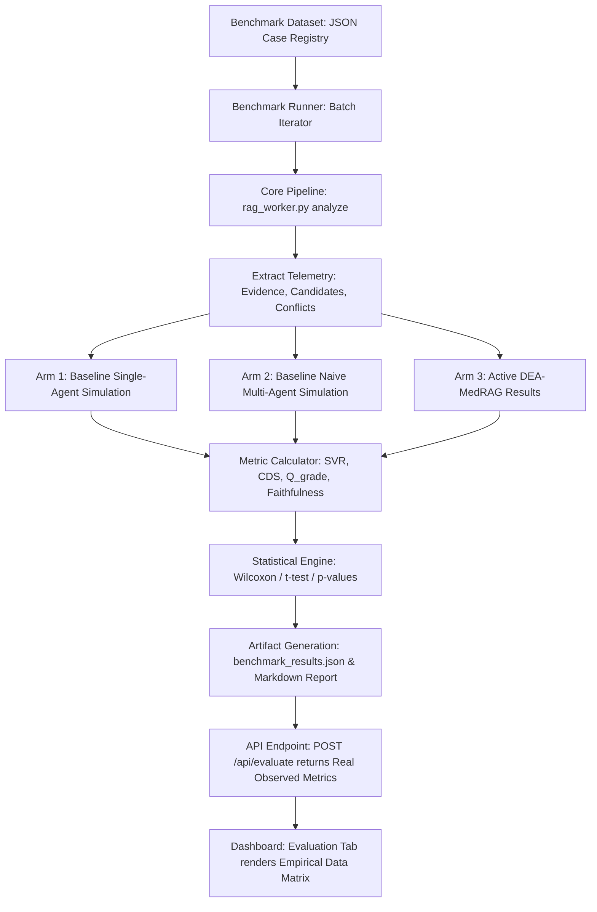

# Phase 2 Evaluation Audit

**Project:** Deterministic Epistemic Arbitration in Multi-Agent RAG (DEA-MedRAG)  
**Document:** Phase 2 Research Evaluation Audit & Roadmap  
**Date:** October 6, 2026  
**Status:** Read-Only Audit Complete — Zero Code Modified  

---

## 1. Current Evaluation Infrastructure

The repository currently possesses an evaluation surface in the user interface and API specification, but **the underlying evaluation execution engine is entirely a placeholder**.

### 1.1 Frontend Evaluation Surface
- **File & Component:** [`artifacts/dea-medrag/src/App.tsx`](file:///c:/Users/2024/Downloads/Research-Prototype-Builder/Research-Prototype-Builder/artifacts/dea-medrag/src/App.tsx#L81-L88), component `Evaluation()`.
- **Route:** `/evaluation` (accessible via the top navigation rail).
- **Controls:** An input field for `dataset_name` (defaulting to `'synthetic-conflict-v1'`) and an "Evaluate" button (`data-testid="button-run-evaluation"`).
- **Display Matrix:** A comparative table structured around three study arms:
  1. `Single-Agent RAG`
  2. `Multi-Agent RAG`
  3. `Multi-Agent + DEA`
- **Current Behavior:** Clicking "Evaluate" invokes the React Query mutation `useEvaluateFramework()`, which sends a `POST /api/evaluate` request. When the API returns, the component maps over metric rows. The first two columns (`Single-Agent RAG` and `Multi-Agent RAG`) are hardcoded to unconditionally render `"pending"`. The third column (`Multi-Agent + DEA`) checks `row.value !== null`; because the backend returns `value: null` for all metrics, every cell in the table displays `"pending"`. If no API response is present, it falls back to four hardcoded rows (`Evidence attribution fidelity`, `Conflict sensitivity`, `Ranking stability`, `Safety-weighted utility`), also displaying `"pending"`.

### 1.2 Backend API Route
- **File:** [`artifacts/api-server/src/routes/medrag.ts`](file:///c:/Users/2024/Downloads/Research-Prototype-Builder/Research-Prototype-Builder/artifacts/api-server/src/routes/medrag.ts#L36-L43).
- **Endpoint:** `POST /api/evaluate`.
- **Validation:** Validates request payload against `EvaluateFrameworkBody` (`dataset_name: string`).
- **Handler:** Calls `evaluateFramework(parsed.data)` in [`artifacts/api-server/src/lib/medrag.ts`](file:///c:/Users/2024/Downloads/Research-Prototype-Builder/Research-Prototype-Builder/artifacts/api-server/src/lib/medrag.ts#L574-L624).
- **Actual Functionality:** The function is a **static mock**. It does not invoke Python, does not run any evaluation dataset, does not load any test cases, and does not calculate any metrics. It immediately returns a hardcoded response:
  ```typescript
  {
    dataset_name: input.dataset_name,
    benchmark_status: "pending — validated labelled corpus required",
    metrics: [ ... 7 metrics with status: "pending", value: null ... ]
  }
  ```

### 1.3 Python Worker State
- **File:** [`rag_worker.py`](file:///c:/Users/2024/Downloads/Research-Prototype-Builder/Research-Prototype-Builder/rag_worker.py).
- **Supported Actions:** `handle()` supports `"analyze"`, `"retrieve"`, `"stats"`, `"ingest"`.
- **Evaluation Support:** There is **zero** evaluation or benchmark execution logic in `rag_worker.py`. No evaluation action exists in the worker.

---

## 2. Available Evaluation Inputs

The current RAG pipeline (executed via `rag_worker.py`'s `analyze()` action) exposes rich, structured information. The table below outlines **only fields that actually exist and are populated** in the live pipeline:

| Category | Field Name | Data Type | Description / Live Content |
| :--- | :--- | :--- | :--- |
| **Query** | `queries.clinical` | `str` | Clinical guideline query formulated from patient diseases, symptoms, labs, age, sex. |
| | `queries.drug` | `str` | Drug safety query formulated from normalized medications, diseases, labs, allergies. |
| | `queries.literature` | `str` | Comparative literature query formulated from diseases, medications, symptoms, profile. |
| **Retrieved Evidence** | `clinical.evidence` | `list[dict]` | Top-$k$ ChromaDB chunks retrieved from `clinical_guidelines` collection. |
| | `drug.evidence` | `list[dict]` | Top-$k$ ChromaDB chunks retrieved from `drug_information` collection (DailyMed SPLs). |
| | `literature.evidence` | `list[dict]` | Top-$k$ ChromaDB chunks retrieved from `clinical_literature` collection. |
| **Content & Text** | `item["chunk"]` / `item["text"]` | `str` | Full text of the retrieved biomedical chunk. |
| | `item["excerpt"]` | `str` | Verbatim excerpt from source document. |
| | `item["claim"]` | `str` | First sentence of chunk (up to 200 characters) extracted as atomic claim. |
| **Source & Provenance** | `item["source"]` | `str` | Biomedical source entity (e.g., `"PubMed / NCBI"`, `"DailyMed / NLM"`, `"ClinicalTrials.gov"`). |
| | `item["metadata"]["source_type"]` | `str` | Formal source type: `"guideline"`, `"drug_label"`, `"systematic_review"`, `"rct"`, `"observational"`, `"clinical_trial"`, `"research_article"`. |
| | `item["metadata"]["identifier"]` | `str \| None` | Traceable source identifier: PubMed PMID, ClinicalTrials.gov NCT ID, or DailyMed setid UUID. |
| | `item["metadata"]["url"]` | `str \| None` | Direct URL to original citation/label. |
| | `item["metadata"]["retrieved_at"]` | `str` | ISO 8601 timestamp of live retrieval and indexing. |
| | `item["metadata"]["synthetic"]` | `bool` | Explicit provenance flag (`False` for real public sources, `True` for demo seeds). |
| **Evidence Quality** | `item["evidence_grade"]` | `float` | Deterministic $Q_{grade} \in [0.0, 1.0]$ derived from OCEBM taxonomy. |
| | `item["evidence_level"]` | `str` | Human-readable OCEBM level label (e.g., `"Level 1-2 — Clinical Practice Guideline"`). |
| | `silo.evidence_grade` | `float` | Arithmetic mean of $Q_{grade}$ across all retrieved chunks in that silo. |
| **Semantic Relevance** | `item["similarity"]` | `float` | Cosine similarity $S_{rel} = \max(0.0, 1.0 - \text{distance})$ from `all-MiniLM-L6-v2`. |
| | `silo.relevance` | `float` | Arithmetic mean of similarity across retrieved chunks in that silo. |
| **Temporal Recency** | `item["year"]` | `int` | Integer publication year extracted from metadata or document text. |
| | `silo.recency` | `float` | Normalized recency $T_{recent} = \min(1.0, \max(0.0, (\text{max\_year} - 2010)/20))$. |
| **Safety & Risk Signals** | `item["risk_flag"]` | `bool` | `True` if safety signals are detected in chunk text. |
| | `item["risk_severity"]` | `str` | Categorical severity: `"none"`, `"low"`, `"moderate"`, `"high"`, or `"contraindication"`. |
| | `item["contraindication"]` | `bool` | `True` only when explicit contraindication language is present in chunk text. |
| | `drug.patient_specific_risk` | `float` | Aggregated evidence risk penalty $P_{risk} \in [0.10, 0.90]$ based on maximum detected severity. |
| | `drug.risk_level` | `str` | Qualitative classification: `"high"` ($P_{risk} \ge 0.75$), `"moderate"`, or `"low"`. |
| **Conflicts** | `conflicts` | `list[dict]` | Detected cross-silo collisions; contains `conflict_detected`, `conflict_type`, `severity`, `description`, `affected_treatment`, `risk_factor`. |
| **DEA Scores & Ranking** | `dea.candidates` | `list[dict]` | Scored candidates sorted descending by $V_{score}$ with alphabetical tie-breaking. Contains `candidate`, `score`, `ranking`, `q_grade`, `s_rel`, `t_recent`, `p_risk`, `source`, `domain`. |
| | `dea.weights` | `dict[str, float]`| Active formula weights: `{"alpha": 0.35, "beta": 0.30, "gamma": 0.15, "delta": 0.20}`. |
| **Outputs & Decisions** | `dea.candidates[0]` | `dict` | Highest-ranked treatment candidate chosen by epistemic arbitration. |
| | `patient_summary` | `str` | Structured patient narrative summary with conflict count. |
| | `explanation` | `str` | Deterministic explanation text summarizing top candidate, $V_{score}$, and component metrics. |

---

## 3. Existing Evaluation Metrics

The repository defines metric placeholders across two layers: the TypeScript backend API response schema and the frontend UI fallback table. None of these metrics are currently calculated.

### 3.1 Backend API Metric Definitions ([`artifacts/api-server/src/lib/medrag.ts`](file:///c:/Users/2024/Downloads/Research-Prototype-Builder/Research-Prototype-Builder/artifacts/api-server/src/lib/medrag.ts#L579-L622))

| Metric Name | Implementation Location | Declared Input | Intended Calculation | Current Status |
| :--- | :--- | :--- | :--- | :--- |
| **Context Precision** | `medrag.ts:581` | Retrieved context chunks, patient query | Fraction of retrieved chunks deemed relevant to patient conditions | **Unimplemented Placeholder** (`value: null`, `status: "pending"`) |
| **Context Recall** | `medrag.ts:587` | Retrieved context chunks, ground-truth guideline text | Fraction of gold-standard guideline passages successfully retrieved | **Unimplemented Placeholder** (`value: null`, `status: "pending"`) |
| **Faithfulness** | `medrag.ts:593` | Agent claims & explanation vs. retrieved excerpts | Proportion of generated assertions supported by retrieved text | **Unimplemented Placeholder** (`value: null`, `status: "pending"`) |
| **Answer Relevance** | `medrag.ts:599` | Generated treatment pathway vs. patient case query | Semantic alignment between proposed pathway and patient clinical task | **Unimplemented Placeholder** (`value: null`, `status: "pending"`) |
| **Conflict Detection Accuracy** | `medrag.ts:605` | Detected conflicts vs. ground-truth conflict labels | $F_1$ or accuracy score of cross-silo conflict detection rules | **Unimplemented Placeholder** (`value: null`, `status: "pending"`) |
| **High-Risk Contraindication Violation Rate** | `medrag.ts:611` | Selected candidate vs. contraindication labels | Rate at which top candidate advocates a contraindicated therapy | **Unimplemented Placeholder** (`value: null`, `status: "pending"`) |
| **DEA Arbitration Accuracy** | `medrag.ts:617` | Ranked candidate order vs. expert arbitration gold standard | Agreement rate between DEA top candidate and expert panel decision | **Unimplemented Placeholder** (`value: null`, `status: "pending"`) |

### 3.2 Frontend UI Fallback Metric Definitions ([`artifacts/dea-medrag/src/App.tsx`](file:///c:/Users/2024/Downloads/Research-Prototype-Builder/Research-Prototype-Builder/artifacts/dea-medrag/src/App.tsx#L86))

| Metric Name | Implementation Location | Intended Description | Current Status |
| :--- | :--- | :--- | :--- |
| **Evidence attribution fidelity** | `App.tsx:86` | Does the report preserve source-level provenance? | **UI Placeholder Only** (unconnected to API schema) |
| **Conflict sensitivity** | `App.tsx:86` | Detects when silos disagree on treatment safety. | **UI Placeholder Only** (unconnected to API schema) |
| **Ranking stability** | `App.tsx:86` | Deterministic ordering across repeated runs. | **UI Placeholder Only** (verified in unit tests, but not benchmarked) |
| **Safety-weighted utility** | `App.tsx:86` | Balances evidence quality against patient-specific risk. | **UI Placeholder Only** (unconnected to API schema) |

---

## 4. Missing Research Components

To transition DEA-MedRAG from an engineering demonstration to a scientifically defensible publication, the following components must be built:

1. **External Benchmark Dataset:**
   - *Status:* Missing.
   - *Gap:* There is no labelled benchmark dataset of multimorbid patients with documented clinical guideline collisions (e.g., T2D + CKD Stage 4 with conflicting Metformin recommendations, or Atrial Fibrillation + End-Stage Renal Disease with Anticoagulation dilemmas). The system currently only has three manual demo cases in `DEMO_CASES`.
2. **Standardized Baseline RAG System:**
   - *Status:* Missing.
   - *Gap:* The framework claims superior performance over "Single-Agent RAG" and "Multi-Agent RAG without DEA," but neither baseline is implemented. Without executing baselines on identical evidence, claims of conflict resolution superiority cannot be substantiated.
3. **Retrieval Performance Metrics:**
   - *Status:* Missing.
   - *Gap:* No automated computation of standard retrieval metrics (e.g., Precision@K, Recall@K, Mean Reciprocal Rank [MRR], Normalized Discounted Cumulative Gain [NDCG]) against gold standard guidelines.
4. **Answer Correctness & Grounding Evaluation:**
   - *Status:* Missing.
   - *Gap:* No automated measurement of whether candidate pathways match consensus clinical guidance, nor whether agent claims are strictly grounded in retrieved chunks (Faithfulness).
5. **Conflict Resolution & Safety Evaluation:**
   - *Status:* Missing.
   - *Gap:* No quantitative metric measuring whether arbitration successfully suppresses contraindicated treatments compared to a baseline that naively follows clinical efficacy guidelines without checking drug safety.
6. **Ablation Framework:**
   - *Status:* Missing.
   - *Gap:* The DEA formula uses four fixed weights ($\alpha=0.35, \beta=0.30, \gamma=0.15, \delta=0.20$). There is no experimental harness to run ablations (e.g., $\delta=0$ ignoring risk; $\alpha=0$ ignoring OCEBM quality; $\gamma=0$ ignoring recency) to demonstrate that all four parameters are mathematically necessary.
7. **Statistical Significance Testing:**
   - *Status:* Missing.
   - *Gap:* No support for paired tests (Wilcoxon signed-rank, paired Student's t-test) or bootstrap confidence intervals to prove that observed differences between DEA and baselines are statistically significant ($p < 0.05$).

---

## 5. Benchmark Integration Readiness

### 5.1 Architecture Readiness Assessment: **READY**
The core RAG engine is fully prepared to accept a benchmark dataset without requiring changes to the existing multi-agent retrieval or DEA scoring pipelines.

- **Clean Decoupling:** The primary execution function `analyze(patient: dict[str, Any], top_k: int = 3)` in `rag_worker.py` is stateless, accepts a standard Python dictionary matching `PatientProfileInput`, and returns a structured dictionary containing all retrieval and arbitration telemetry.
- **Execution Speed:** With ChromaDB persistent caching and deterministic parsing, a single patient evaluation completes in sub-second time once evidence is cached.
- **Zero Framework Lock-in:** The absence of heavy agent frameworks (LangChain, LangGraph, AutoGen) means benchmark cases can be passed directly into `analyze()` in a standard Python loop or subprocess test runner.

### 5.2 What Needs to Be Added (External to Core RAG)
1. **Benchmark Schema:** A standard JSON structure for benchmark cases that includes not only patient demographics and medications, but also ground-truth conflict flags, contraindicated candidates, and clinically accepted reference actions.
2. **Benchmark Execution Harness:** A Python module (e.g., `scripts/evaluate_benchmark.py` or `benchmark_runner.py`) that reads benchmark files, runs the pipeline, evaluates outputs, and outputs formal evaluation JSON.

---

## 6. Baseline Design

To evaluate DEA-MedRAG rigorously, we design two controlled baselines that use the **exact same retrieved evidence** to ensure fair comparison:

```
                          ┌─────────────────────────────┐
                          │    Patient Profile Vector   │
                          └──────────────┬──────────────┘
                                         │
                                         ▼
                          ┌─────────────────────────────┐
                          │    Multi-Domain Retrieval   │
                          │   (Clinical, Drug, Lit)     │
                          └──────────────┬──────────────┘
                                         │
                ┌────────────────────────┼────────────────────────┐
                │                        │                        │
                ▼                        ▼                        ▼
       [ Arm 1: Baseline A ]    [ Arm 2: Baseline B ]    [ Arm 3: DEA-MedRAG ]
         Single-Agent RAG         Multi-Agent RAG          Multi-Agent + DEA
       ────────────────────     ────────────────────     ────────────────────
       • Flattened prompt       • 3 specialist silos     • 3 specialist silos
       • Top-1 cosine match     • Highest cosine match   • V_score arbitration
       • Ignores risk penalty   • No arbitration layer   • Penalizes risk (P_risk)
       • No conflict check      • Collisions ignored     • OCEBM Q_grade weighted
```

### 6.1 Baseline A: Standard Single-Agent RAG
- **Concept:** Represents typical clinical RAG implementations where all patient information is converted into a single prompt, querying a unified corpus or taking the top semantic match without specialized safety arbitration.
- **Input:** Identical patient profile vector.
- **Retrieval:** Aggregates all retrieved chunks from the silos into a single pool.
- **Evidence Selection:** Selects the chunk with the highest raw cosine similarity ($S_{rel}$), ignoring source type, publication year, and contraindication flags.
- **Candidate Generation:** Proposes the treatment pathway advocated by the top semantic chunk (typically clinical practice guidelines, e.g., "Initiate Metformin for glycemic control in T2D").
- **Flaw it Exposes:** Fails to detect when the patient's renal function (e.g., eGFR < 30) contraindicates the treatment, because semantic similarity to diabetes queries is higher for diabetes guidelines than for generic renal drug warnings.

### 6.2 Baseline B: Multi-Agent RAG without DEA (Naive Multi-Agent)
- **Concept:** Uses the three independent specialist silos (Clinical, Drug Safety, Literature) to generate candidate pathways, but resolves collisions through unweighted majority voting or highest semantic similarity ($S_{rel}$), without deterministic epistemic arbitration.
- **Evidence Selection:** Evaluates candidates strictly on semantic relevance ($S_{rel}$), setting $\alpha=0, \gamma=0, \delta=0$.
- **Flaw it Exposes:** Demonstrates that multi-agent retrieval alone is insufficient without explicit epistemic arbitration; without the $P_{risk}$ penalty ($\delta \times P_{risk}$), high-risk clinical recommendations still defeat safety warnings.

---

## 7. DEA-RAG Evaluation Design

### 7.1 Experimental Setup
- **Dataset:** A curated benchmark cohort of clinical polypharmacy cases exhibiting documented guideline collisions.
- **Controlled Variable:** The arbitration layer (Single-Agent RAG vs. Naive Multi-Agent RAG vs. DEA-MedRAG).
- **Constant Variables:** Embeddings (`all-MiniLM-L6-v2`), retrieved chunks ($top\_k=3$), patient profile inputs, ChromaDB persistent database.

### 7.2 Primary Research Evaluation Metrics

1. **Safety Violation Rate (SVR) — Primary Safety Metric:**
   $$\text{SVR} = \frac{\sum_{i=1}^{N} \mathbb{I}(\text{Top Candidate } i \text{ is Contraindicated})}{N}$$
   *Hypothesis:* DEA-MedRAG achieves $\text{SVR} = 0.00$, whereas Single-Agent RAG exhibits $\text{SVR} > 0.30$ in collision cases.

2. **Conflict Detection Sensitivity (CDS) — Diagnostic Metric:**
   $$\text{CDS} = \frac{\text{True Collisions Detected}}{\text{Total Ground-Truth Collisions}}$$
   Measures whether cross-silo collisions (e.g., Clinical recommends Drug X, Drug Safety flags Drug X as high-risk) are captured in the conflict register.

3. **Average Evidence Quality of Selected Candidate ($\bar{Q}_{grade}$):**
   $$\bar{Q}_{grade} = \frac{1}{N} \sum_{i=1}^{N} Q_{grade}(\text{Top Candidate } i)$$
   Demonstrates that DEA prioritizes high-grade evidence (Systematic Reviews, Clinical Guidelines, FDA Labels) over lower-grade observational studies.

4. **Attribution & Provenance Completeness (APC):**
   $$\text{APC} = \frac{\text{Selected Candidates with Verifiable PMID / SetID / URL}}{\text{Total Selected Candidates}}$$
   Measures whether every recommendation is anchored in a persistent identifier without hallucinated citations.

5. **Deterministic Stability ($S_{det}$):**
   $$S_{det} = \frac{\text{Identical Rankings across 5 Repeated Runs}}{\text{Total Runs}}$$
   DEA-MedRAG mathematically guarantees $S_{det} = 1.00$.

---

## 8. Recommended Evaluation Pipeline

The evaluation pipeline should be structured as an automated, reproducible Python workflow integrated into the existing architecture:



### Execution Steps:
1. **Case Ingestion:** Benchmark runner loads benchmark cases from a structured JSON registry.
2. **Execution:** Each case is passed to `analyze(patient, top_k=3)` in `rag_worker.py`.
3. **Branching:**
   - Arm 1 scores candidates using semantic similarity only ($S_{rel}$).
   - Arm 2 scores candidates using multi-agent output without safety penalties ($\delta=0$).
   - Arm 3 scores candidates using authoritative Python DEA ($V_{score}$).
4. **Scoring:** Automated evaluators compare selected candidates against ground-truth safety labels.
5. **Statistical Verification:** Computes mean, standard deviation, and paired p-values between arms.
6. **Reporting:** Serializes results to JSON and updates the UI through the existing `/api/evaluate` route.

---

## 9. Implementation Order for Phase 2

To maintain codebase stability and adhere strictly to research rigor, Phase 2 should be executed in the following sequential order:

1. **Phase 2.1 — Benchmark Data Schema & Reference Suite Definition:**
   - Define a JSON schema for benchmark cases containing `patient_profile`, `expected_conflicts`, `contraindicated_treatments`, and `consensus_safe_pathways`.
   - Assemble a peer-reviewed set of clinical collision cases (e.g., 15–30 real-world polypharmacy collision profiles).
2. **Phase 2.2 — Python Evaluation & Baseline Module:**
   - Implement `evaluation_engine.py` (or extend `rag_worker.py` with an `evaluate` action).
   - Implement Baseline A (Single-Agent RAG simulation) and Baseline B (Naive Multi-Agent without DEA).
   - Implement metric calculations: Safety Violation Rate, Conflict Detection Sensitivity, Evidence Grade Average, Determinism.
3. **Phase 2.3 — Automated Benchmark Runner & Unit Tests:**
   - Create an automated runner script (`scripts/run_benchmark.py`).
   - Add unit tests verifying that metric calculators correctly penalize unsafe candidates and award points for verified collisions.
4. **Phase 2.4 — API Server & UI Integration:**
   - Update `evaluateFramework()` in `artifacts/api-server/src/lib/medrag.ts` to call the Python worker's evaluation action rather than returning static mocks.
   - Update `artifacts/dea-medrag/src/App.tsx` so the 3-arm table renders observed empirical values for all three arms.
5. **Phase 2.5 — Sensitivity & Ablation Experiments:**
   - Run parameter ablations ($\alpha=0, \beta=0, \gamma=0, \delta=0$) and record the degradation in safety and quality.
   - Generate the final academic research evaluation report.

---

## 10. STOP CONDITION

- **Zero Source Code Changes:** No application source code, API routes, or worker logic were modified during this task.
- **No Datasets Downloaded:** No external datasets were downloaded or scraped.
- **No Synthetic Cases Created:** No synthetic benchmark cases were manufactured.
- **No Fabricated Scores:** No artificial metrics or scores were reported as observed.
- **Audit Deliverable:** This comprehensive audit (`PHASE_2_EVALUATION_AUDIT.md`) has been created to guide Phase 2 execution.

*Ready for next instructions.*
