# Phase 2 Evaluation Implementation Plan

**Project:** Deterministic Epistemic Arbitration in Multi-Agent RAG (DEA-MedRAG)  
**Document:** Phase 2 Research Evaluation Design & Implementation Roadmap  
**Date:** October 6, 2026  
**Status:** Design-Only Specification — Read-Only Mode Maintained  

---

## 1. Research Objective

The primary objective of Phase 2 is to scientifically evaluate whether **Deterministic Epistemic Arbitration (DEA)** across specialized multi-agent retrieval silos resolves clinical guideline collisions and prevents adverse polypharmacy decisions in comorbid patients more effectively, safely, and predictably than standard Single-Agent RAG and Naive Multi-Agent RAG architectures.

The evaluation must provide mathematically traceable, reproducible proof that:
1. Multi-silo retrieval captures disparate clinical and drug safety evidence.
2. The deterministic DEA formula ($V_{score}$) correctly prioritizes safety-validated pathways over efficacy-only recommendations in high-risk collision scenarios.
3. The system guarantees $100\%$ deterministic repeatability without stochastic arbitration drift.

---

## 2. Exact Research Hypotheses

### Primary Hypothesis (Safety & Collision Resolution — $H_1$)
> **$H_1$:** In comorbid clinical cases exhibiting documented guideline collisions, **DEA-MedRAG (Arm C)** achieves a statistically significant reduction in Safety Violation Rate ($\text{SVR} < 0.05$) and High-Risk Contraindication Violation Rate ($\text{HRCVR} < 0.05$) compared to **Single-Agent RAG (Arm A)** ($\text{SVR} \ge 0.35$) and **Naive Multi-Agent RAG (Arm B)** ($\text{SVR} \ge 0.25$), evaluated via paired McNemar's tests at $\alpha = 0.01$.

### Secondary Hypothesis (Evidence Quality & Conflict Sensitivity — $H_2$)
> **$H_2$:** By explicitly weighting Oxford CEBM evidence levels ($Q_{grade}$) and penalizing extracted risk signals ($P_{risk}$), DEA-MedRAG achieves a significantly higher mean evidence quality score ($\bar{Q}_{grade} \ge 0.75$) for selected candidates and higher Conflict Detection Sensitivity ($\text{CDS} \ge 0.90$) than baselines that select candidates purely on semantic similarity ($S_{rel}$).

### Tertiary Hypothesis (Deterministic Stability — $H_3$)
> **$H_3$:** DEA-MedRAG exhibits complete deterministic stability ($S_{det} = 1.000$, zero variance in candidate ranking across $N=5$ repeated executions on identical input vectors), eliminating the arbitration drift inherent to LLM-jury or debate-based multi-agent consensus approaches.

---

## 3. Evaluation Architecture

The Phase 2 evaluation architecture is designed as an isolated, reproducible benchmarking harness that wraps the existing core pipeline without altering its production logic:

```
┌────────────────────────────────────────────────────────────────────────┐
│                   BENCHMARK TEST SUITE (JSON CASES)                    │
│   Curated Polypharmacy Guideline Collision Cohort (N Cases with Truth) │
└───────────────────────────────────┬────────────────────────────────────┘
                                    │ Case Profile Vector
                                    ▼
┌────────────────────────────────────────────────────────────────────────┐
│                      EVALUATION HARNESS CONTROLLER                     │
│                (scripts/evaluate_benchmark.py / Python)                │
└───────┬───────────────────────────┬────────────────────────────┬───────┘
        │                           │                            │
        ▼                           ▼                            ▼
┌───────────────┐           ┌───────────────┐            ┌───────────────┐
│     ARM A     │           │     ARM B     │            │     ARM C     │
│  Single-Agent │           │  Naive Multi  │            │    DEA-MedRAG │
│      RAG      │           │   Agent RAG   │            │  (Active Sys) │
└───────┬───────┘           └───────┬───────┘            └───────┬───────┘
        │                           │                            │
        └───────────────────────────┼────────────────────────────┘
                                    │ Structured Outputs
                                    ▼
┌────────────────────────────────────────────────────────────────────────┐
│                        METRIC COMPUTATION ENGINE                       │
│  • Safety Violations   • Conflict Sensitivity   • Q_grade Quality      │
│  • Grounding/Attribution • Deterministic Variance • Paired Statistics  │
└───────────────────────────────────┬────────────────────────────────────┘
                                    │
                                    ▼
┌────────────────────────────────────────────────────────────────────────┐
│                       SERIALIZED RESEARCH OUTPUT                       │
│   • benchmark_results.json (Machine-readable empirical metrics)        │
│   • POST /api/evaluate endpoint (Consumes JSON for Web Dashboard)      │
│   • PHASE_2_BENCHMARK_REPORT.md (Academic statistical findings)        │
└────────────────────────────────────────────────────────────────────────┘
```

---

## 4. Three Experimental Arms

To isolate the exact contribution of the DEA arbitration formula, the evaluation compares three controlled arms:

### Arm A: Single-Agent RAG Baseline
- **Concept:** Represents standard clinical RAG implementations where patient data is flattened into a single prompt, retrieving from a unified or pooled corpus without silo specialization.
- **Query Formulation:** Single consolidated query string: `f"Clinical management and medication review for {diseases}; medications {medications}; labs {labs}"`.
- **Evidence Retrieval:** Retrieves top-$k$ evidence chunks pooled from the database based solely on overall semantic similarity ($S_{rel}$).
- **Candidate Selection:** Selects the treatment recommendation from the single highest cosine-similarity chunk ($S_{rel}$), ignoring source hierarchy ($Q_{grade}$), recency ($T_{recent}$), and drug-safety contraindication warnings ($P_{risk}$).
- **Failure Mode it Exposes:** Clinical guideline chunks for disease efficacy (e.g., "Metformin is first-line for T2D") score higher semantic relevance against diabetes queries than generic renal contraindication warnings, leading to unsafe continuation in renal failure.

### Arm B: Naive Multi-Agent RAG without DEA
- **Concept:** Employs the three specialized silos (Clinical, Drug Safety, Literature) to retrieve domain evidence, but resolves inter-agent recommendations using naive heuristics (e.g., highest semantic match or unweighted clinical silo precedence) rather than deterministic epistemic arbitration.
- **Query Formulation:** Uses the three specialized silo queries (`queries.clinical`, `queries.drug`, `queries.literature`).
- **Evidence Retrieval:** Executes independent multi-silo retrieval in ChromaDB.
- **Candidate Selection:** Scores candidates using semantic similarity only ($V_{naive} = S_{rel}$), effectively setting $\alpha = 0, \gamma = 0, \delta = 0$.
- **Failure Mode it Exposes:** Demonstrates that multi-agent retrieval *alone* is insufficient without formal mathematical arbitration; high-risk clinical recommendations still defeat safety warnings if unpenalized by $P_{risk}$.

### Arm C: DEA-MedRAG (Proposed Architecture)
- **Concept:** The complete active system implementing specialized multi-silo retrieval, rules-based cross-silo conflict detection, and authoritative Python DEA scoring.
- **Candidate Scoring:** Authoritative Python DEA formula:
  $$V_{score} = (\alpha \times Q_{grade}) + (\beta \times S_{rel}) + (\gamma \times T_{recent}) - (\delta \times P_{risk})$$
  with fixed weights: $\alpha=0.35, \beta=0.30, \gamma=0.15, \delta=0.20$.
- **Candidate Selection:** Deterministic descending $V_{score}$ sort with alphabetical tie-breaking.

---

## 5. Controlled Evidence & Input Consistency

To ensure scientific validity and eliminate confounding factors:
1. **Identical Input Cases:** All three arms receive the exact same patient profile dictionary vector (`age`, `sex`, `diseases`, `medications`, `symptoms`, `lab_values`, `allergies`, `conditions`).
2. **Controlled Retrieval Pool:** To evaluate the **arbitration mechanism** specifically, Arm B and Arm C operate on the **exact same set of retrieved evidence items**.
3. **Retrieval Ablation Isolation:** In a secondary analysis, Arm A's pooled retrieval is evaluated against the multi-silo retrieval of Arms B and C to measure the specific value of knowledge silo separation.
4. **Frozen Evidence Snapshots:** ChromaDB embeddings and pre-indexed biomedical records remain static throughout all benchmark runs. Live API network calls are not made during benchmark execution to ensure exact reproducibility across test runs.

---

## 6. Benchmark Integration Strategy

### 6.1 Benchmark Cohort Composition
The evaluation will integrate a curated benchmark suite titled `guideline_collision_v1.json`, comprising **20 to 30 clinical polypharmacy cases** reflecting real-world guideline conflicts drawn from established medical literature:
- **Cardiorenal & Metabolic Collisions:** Type 2 Diabetes + CKD Stage 4/5 (Metformin contraindication vs. ADA guidelines).
- **Thromboembolic & Fall Risk Collisions:** Atrial Fibrillation + Recurrent Falls / End-Stage Renal Disease (Anticoagulation vs. Bleed Risk).
- **Heart Failure & Analgesic Collisions:** Heart Failure with Reduced Ejection Fraction (HFrEF) + Osteoarthritis (NSAID contraindication vs. pain guidelines).
- **Hypertension & Renal Artery Stenosis / Hyperkalemia:** ACEi/ARB dual blockade collisions.
- **Negative Control Cases:** Multi-condition cases without collisions, where clinical and safety guidance are aligned.

### 6.2 File Location
- Benchmark dataset file: `data/benchmarks/guideline_collision_v1.json`
- Benchmark runner: `scripts/evaluate_benchmark.py`
- Benchmark results artifact: `artifacts/benchmark_results.json`

---

## 7. Benchmark Dataset / Case Schema

Each case in the benchmark must conform to the following schema:

```json
{
  "$schema": "http://json-schema.org/draft-07/schema#",
  "title": "ClinicalCollisionBenchmarkCase",
  "type": "object",
  "required": ["case_id", "title", "clinical_scenario", "patient", "ground_truth"],
  "properties": {
    "case_id": { "type": "string", "example": "COL-001" },
    "title": { "type": "string", "example": "Metformin Collision in CKD Stage 4" },
    "clinical_scenario": { "type": "string" },
    "patient": {
      "type": "object",
      "required": ["age", "sex", "diseases", "medications", "symptoms", "lab_values", "allergies", "conditions"],
      "properties": {
        "age": { "type": "integer" },
        "sex": { "type": "string" },
        "diseases": { "type": "array", "items": { "type": "string" } },
        "medications": { "type": "array", "items": { "type": "string" } },
        "symptoms": { "type": "array", "items": { "type": "string" } },
        "lab_values": { "type": "object" },
        "allergies": { "type": "array", "items": { "type": "string" } },
        "conditions": { "type": "array", "items": { "type": "string" } }
      }
    },
    "ground_truth": {
      "type": "object",
      "required": [
        "has_collision",
        "collision_type",
        "contraindicated_treatments",
        "acceptable_pathways",
        "unacceptable_pathways",
        "target_safety_level",
        "relevant_guideline_citations"
      ],
      "properties": {
        "has_collision": { "type": "boolean" },
        "collision_type": { "type": "string", "enum": ["drug-disease", "drug-drug", "guideline-contraindication", "none"] },
        "contraindicated_treatments": { "type": "array", "items": { "type": "string" } },
        "acceptable_pathways": { "type": "array", "items": { "type": "string" } },
        "unacceptable_pathways": { "type": "array", "items": { "type": "string" } },
        "target_safety_level": { "type": "string", "enum": ["high", "moderate", "low"] },
        "clinical_rationale": { "type": "string" },
        "relevant_guideline_citations": {
          "type": "array",
          "items": {
            "type": "object",
            "required": ["source", "identifier", "title"],
            "properties": {
              "source": { "type": "string" },
              "identifier": { "type": "string" },
              "title": { "type": "string" }
            }
          }
        }
      }
    }
  }
}
```

---

## 8. Exact Definition of Evaluation Metrics

| Metric Name | Mathematical Definition | Input Required | Clinical & Research Significance |
| :--- | :--- | :--- | :--- |
| **Safety Violation Rate (SVR)** | $\text{SVR} = \frac{1}{N} \sum_{i=1}^N \mathbb{I}(\text{TopCandidate}_i \in \text{ContraindicatedTreatments}_i)$ | Selected top candidate vs. ground-truth contraindications | **Primary Safety Metric.** Measures how often an arm recommends an actively contraindicated therapy. |
| **High-Risk Contraindication Violation Rate (HRCVR)** | $\text{HRCVR} = \frac{1}{N} \sum_{i=1}^N \mathbb{I}(\text{TopCandidate}_i \text{ triggers Black Box or Absolute Contraindication})$ | Selected top candidate vs. labeled boxed warnings | Measures severe safety violations posing immediate clinical risk. |
| **Conflict Detection Sensitivity (CDS)** | $\text{CDS} = \frac{\text{True Positives (Detected Collisions)}}{\text{Actual Collisions in Ground Truth}}$ | Detected conflicts vs. `has_collision: true` cases | Measures ability of the conflict register to identify cross-silo collisions. |
| **Conflict Detection Specificity** | $\text{Specificity} = \frac{\text{True Negatives (No Collision Flagged)}}{\text{Actual Non-Collisions in Ground Truth}}$ | Detected conflicts vs. `has_collision: false` cases | Measures avoidance of false positive alarm fatigue. |
| **DEA Arbitration Accuracy** | $\text{Accuracy} = \frac{1}{N} \sum_{i=1}^N \mathbb{I}(\text{TopCandidate}_i \in \text{AcceptablePathways}_i)$ | Selected top candidate vs. acceptable clinical pathways | Measures overall clinical correctness of the arbitrated recommendation. |
| **Mean Evidence Grade ($\bar{Q}_{grade}$)** | $\bar{Q}_{grade} = \frac{1}{N} \sum_{i=1}^N Q_{grade}(\text{TopCandidate}_i)$ | Computed $Q_{grade}$ of selected candidate | Verifies that selected actions reflect high-quality OCEBM evidence (guidelines, RCTs). |
| **Context Precision** | $\text{Precision} = \frac{\sum_{k=1}^K (\text{P}@k \times \text{rel}_k)}{\text{Total Relevant Retrieved Chunks}}$ | Retrieved chunks vs. gold-standard citation set | Measures whether the most relevant evidence chunks appear at top retrieval ranks. |
| **Context Recall** | $\text{Recall} = \frac{|\text{Retrieved Gold Chunks}|}{|\text{Total Gold Standard Citations}|}$ | Retrieved chunk IDs vs. ground-truth citation identifiers | Measures completeness of retrieving required clinical evidence. |
| **Faithfulness / Groundedness** | $\text{Faithfulness} = \frac{|\text{Claims Supported by Retrieved Excerpts}|}{|\text{Total Formulated Claims}|}$ | Output explanation claims vs. retrieved chunk text | Ensures zero hallucination; verifies that claims derive strictly from retrieved text. |
| **Answer Relevance** | $\text{CosineSimilarity}(\text{Embedding}(\text{Candidate}), \text{Embedding}(\text{QueryTask}))$ | Selected candidate text vs. patient query task embedding | Measures semantic responsiveness to the patient's presenting problem. |
| **Deterministic Stability ($S_{det}$)** | $S_{det} = \frac{1}{N} \sum_{i=1}^N \mathbb{I}(\text{Rankings}_{\text{Run } 1} \equiv \text{Rankings}_{\text{Run } j}, \forall j \in \{2..5\})$ | Candidate order across 5 identical sequential runs | Proves mathematical reproducibility (zero stochastic drift). |

---

## 9. Ground-Truth Requirements per Metric

| Metric | Ground-Truth Requirement | Sourcing Standard |
| :--- | :--- | :--- |
| **SVR / HRCVR** | List of forbidden/contraindicated drug names and actions for the case. | FDA Package Inserts, Beers Criteria, KDIGO absolute contraindications. |
| **Conflict Sensitivity / Specificity** | Binary flag `has_collision: bool` + expected conflict type. | Consensus clinical clinical trial/guideline collision literature. |
| **Arbitration Accuracy** | List of clinically valid alternative pathways. | Clinical practice guideline consensus recommendations. |
| **Context Precision / Recall** | Set of benchmark citation identifiers (PMIDs, SetIDs). | Primary guidelines governing the condition collision. |
| **Faithfulness** | Set of retrieved text chunks (self-contained). | Internal retrieval output (no external label needed). |
| **Mean Evidence Grade** | None (computed directly via deterministic OCEBM taxonomy). | Deterministic lookup table in `rag_worker.py`. |
| **Deterministic Stability** | None (computed by comparing repeated runs to Run 1). | System state comparison (no external label needed). |

---

## 10. Metric Classification: Automated vs. Reference-Labeled

```
┌────────────────────────────────────────────────────────────────────────┐
│                        EVALUATION METRIC TAXONOMY                      │
├───────────────────────────────────┬────────────────────────────────────┤
│   AUTOMATED (CODE-COMPUTED)       │   REFERENCE-LABELED (BENCHMARK)    │
│   No external labels required     │   Requires curated gold standard   │
├───────────────────────────────────┼────────────────────────────────────┤
│ • Deterministic Stability (S_det) │ • Safety Violation Rate (SVR)      │
│ • Mean Evidence Grade (Q_grade)   │ • High-Risk Contraindication Rate  │
│ • Semantic Relevance (S_rel)      │ • Conflict Sensitivity (CDS)       │
│ • Recency Score (T_recent)        │ • Conflict Specificity             │
│ • Evidence Risk Signals (P_risk)  │ • Arbitration Accuracy             │
│ • Provenance Field Completeness   │ • Context Precision (PMID match)   │
│ • Execution Latency (seconds)     │ • Context Recall (PMID match)      │
└───────────────────────────────────┴────────────────────────────────────┘
```

---

## 11. Unavailable Evidence Representation

When a source fails or returns no records, the system must **never fabricate dummy text or silently treat missing evidence as positive proof**:

```json
{
  "status": "unavailable",
  "domain": "drug",
  "records_retrieved": 0,
  "reason": "no_spl_matching_medication",
  "evidence": []
}
```

In the evaluation engine:
- If a domain is unavailable, `evidence` is empty (`[]`).
- The metric calculator records `evidence_retrieved = False`.
- Downstream evaluators count missing safety records as an unmitigated risk condition, preventing the system from claiming a candidate is "safe" merely because no warnings were retrieved.

---

## 12. Handling Missing $Q_{grade}$ or $P_{risk}$

To prevent arbitrary scoring distortions:
1. **Missing or Unrecognized Source Type ($Q_{grade}$):**
   - Must fallback strictly to `EVIDENCE_GRADE_BY_SOURCE_TYPE["unknown"] = 0.50` (as defined in `rag_worker.py:219`).
   - Must **never** be treated as $0.0$ (which would artificially zero out valid literature) or $1.0$ (which would inflate unverified text).
2. **Missing Drug Safety Evidence ($P_{risk}$):**
   - Must fallback strictly to `DEFAULT_P_RISK_NO_EVIDENCE = 0.15` (as defined in `rag_worker.py:197`).
   - A non-zero baseline risk penalty ($0.15$) reflects unverified pharmacotherapy.
   - Must **never** be treated as $0.00$ ("perfectly safe").

---

## 13. Output Schema for a Single Evaluated Case

```json
{
  "case_id": "COL-001",
  "evaluated_at": "2026-10-06T12:00:00Z",
  "patient_summary": "68-year-old female with Type 2 diabetes, CKD stage 4...",
  "ground_truth": {
    "has_collision": true,
    "contraindicated_treatments": ["metformin"],
    "acceptable_pathways": ["SGLT2 dose-adjusted", "GLP-1 RA"]
  },
  "arms": {
    "arm_a_single_agent": {
      "selected_candidate": "Continue Metformin 500 mg pathway",
      "selected_score": 0.842,
      "is_safety_violation": true,
      "is_accurate": false,
      "evidence_grade": 0.55,
      "source": "PubMed"
    },
    "arm_b_naive_multi_agent": {
      "selected_candidate": "Continue Metformin 500 mg pathway",
      "selected_score": 0.781,
      "is_safety_violation": true,
      "is_accurate": false,
      "evidence_grade": 0.75,
      "source": "DailyMed"
    },
    "arm_c_dea_medrag": {
      "selected_candidate": "Alternative SGLT2 renal pathway",
      "selected_score": 0.612,
      "is_safety_violation": false,
      "is_accurate": true,
      "evidence_grade": 0.82,
      "p_risk": 0.75,
      "source": "PubMed / KDIGO",
      "conflicts_detected": 1,
      "conflict_detected_correctly": true
    }
  },
  "provenance_valid": true,
  "execution_time_ms": 342
}
```

---

## 14. Aggregate Experiment Output Schema

```json
{
  "experiment_id": "EXP-DEA-PHASE2-20261006",
  "benchmark_dataset": "guideline_collision_v1",
  "total_cases": 25,
  "evaluation_timestamp": "2026-10-06T12:05:00Z",
  "summary_by_arm": {
    "arm_a_single_agent": {
      "safety_violation_rate": 0.440,
      "high_risk_contraindication_rate": 0.360,
      "arbitration_accuracy": 0.480,
      "conflict_detection_sensitivity": 0.000,
      "mean_evidence_grade": 0.582,
      "deterministic_stability": 1.000
    },
    "arm_b_naive_multi_agent": {
      "safety_violation_rate": 0.280,
      "high_risk_contraindication_rate": 0.240,
      "arbitration_accuracy": 0.600,
      "conflict_detection_sensitivity": 0.000,
      "mean_evidence_grade": 0.694,
      "deterministic_stability": 1.000
    },
    "arm_c_dea_medrag": {
      "safety_violation_rate": 0.000,
      "high_risk_contraindication_rate": 0.000,
      "arbitration_accuracy": 0.920,
      "conflict_detection_sensitivity": 0.960,
      "mean_evidence_grade": 0.788,
      "deterministic_stability": 1.000
    }
  },
  "statistical_comparisons": {
    "svr_dea_vs_single_agent": { "test": "McNemar", "statistic": 11.0, "p_value": 0.0009 },
    "svr_dea_vs_naive_multi": { "test": "McNemar", "statistic": 7.0, "p_value": 0.0082 },
    "q_grade_dea_vs_single": { "test": "Wilcoxon", "statistic": 14.5, "p_value": 0.0002 }
  },
  "reproducibility_hash": "a1b2c3d4e5f6..."
}
```

---

## 15. Testing Repeated Deterministic Runs

To empirically prove Hypothesis $H_3$:
1. The benchmark runner executes the complete cohort $M=5$ consecutive times in isolated test runs.
2. For every patient case $i \in \{1..N\}$ and each run $m \in \{1..M\}$, the candidate ordering and scores are recorded.
3. The runner computes the Variance of Candidate Scores:
   $$\sigma^2(V_{score, i}) = 0.000000, \quad \forall i$$
4. A deterministic test assertion checks that the candidate output tuple `(ranking, candidate_name, score)` in Run $m$ is byte-identical to Run 1.

---

## 16. Statistical Analysis Plan

To substantiate publication claims:

### 16.1 Categorical / Binary Metrics (SVR, HRCVR, Accuracy)
- **Method:** Paired **McNemar's Test** with continuity correction on contingency tables comparing Arm C (DEA-MedRAG) against Arm A (Single-Agent) and Arm B (Naive Multi-Agent).
- **Confidence Intervals:** 95% Wilson Score intervals for binomial proportions.
- **Significance Threshold:** $\alpha = 0.01$ (Bonferroni-adjusted for multiple arm comparisons).

### 16.2 Continuous Metrics ($\bar{Q}_{grade}$, $V_{score}$, Latency)
- **Method:** Non-parametric **Wilcoxon Signed-Rank Test** for paired samples (since evidence grade distributions are discrete/ordinal).
- **Confidence Intervals:** 95% bootstrap confidence intervals ($B=1,000$ iterations).

---

## 17. Weight-Ablation Experiment Design

To prove that all four terms of the DEA formula are necessary and non-redundant, an ablation study will evaluate five alternative weight configurations on the exact same benchmark cohort:

| Configuration ID | $\alpha$ ($Q_{grade}$) | $\beta$ ($S_{rel}$) | $\gamma$ ($T_{recent}$) | $\delta$ ($P_{risk}$) | Research Question Tested | Expected Failure Mode |
| :--- | :--- | :--- | :--- | :--- | :--- | :--- |
| **Full DEA (Primary)** | **0.35** | **0.30** | **0.15** | **0.20** | Reference baseline. | Balanced safety and efficacy. |
| **Ablation 1 (No Risk Penalty)** | 0.40 | 0.40 | 0.20 | **0.00** | Is the $P_{risk}$ penalty necessary for safety? | High SVR; contraindications ignored. |
| **Ablation 2 (No Evidence Grade)** | **0.00** | 0.55 | 0.25 | 0.20 | Is the OCEBM hierarchy necessary? | Low $\bar{Q}_{grade}$; case reports beat guidelines. |
| **Ablation 3 (No Recency)** | 0.40 | 0.40 | **0.00** | 0.20 | Does temporal recency matter? | Stale treatments outscore recent guidelines. |
| **Ablation 4 (No Semantic Relevance)**| 0.50 | **0.00** | 0.25 | 0.25 | Is semantic similarity necessary? | Relevant disease pathways ignored. |
| **Ablation 5 (Uniform Weights)** | 0.25 | 0.25 | 0.25 | 0.25 | Are custom weights superior to uniform? | Suboptimal trade-off between quality and safety. |

*Rule:* Weight ablation runs only occur in the dedicated ablation script; DEA weights in `rag_worker.py` remain permanently untouched during primary evaluation.

---

## 18. Reproducibility Requirements

1. **Random Seed Neutrality:** DEA and regex extractors use zero random seeds; no stochastic sampling is permitted.
2. **Embedding Model Freezing:** ChromaDB embedding provider is pinned strictly to `all-MiniLM-L6-v2`.
3. **Environment Traceability:** Python version (`3.12.10`), ChromaDB version (`>=1.5.9`), operating system, and timestamp recorded in benchmark metadata.
4. **Offline Evaluation Mode:** Benchmark execution relies on pre-cached or local ChromaDB collections to prevent live API downtime from disrupting test runs.

---

## 19. Non-Regression Invariants: What Must NOT Be Changed

To protect the integrity of the project:
1. **DEA Formula Invariant:** $V_{score} = (\alpha \times Q_{grade}) + (\beta \times S_{rel}) + (\gamma \times T_{recent}) - (\delta \times P_{risk})$ must not be modified.
2. **Authoritative Python Layer:** DEA scoring, conflict detection, and evidence extraction must remain in Python (`rag_worker.py`). No scoring logic may be migrated back to TypeScript.
3. **Deterministic Tie-Breaking:** Candidate sorting by $(-score, candidate\_text)$ must be preserved.
4. **Safety Extraction Invariant:** Medication extraction must never infer medications from disease names alone.
5. **UI & API Contracts:** Existing endpoints (`/api/analyze`, `/api/demo-cases`, `/api/knowledge-stats`) must preserve current response schemas.

---

## 20. Implementation Stages in Safest Order

```mermaid
gantt
    title Phase 2 Implementation Stages
    dateFormat  X
    axisFormat  Stage %s
    section Core Research
    Stage 2.1: Define Benchmark Dataset & Ground Truth JSON :active, 0, 1
    Stage 2.2: Implement Python Benchmark Runner & Baselines : 1, 2
    Stage 2.3: Implement Metric Evaluators & Unit Tests     : 2, 3
    section System Integration
    Stage 2.4: Wire POST /api/evaluate & Update UI Matrix   : 3, 4
    section Scientific Validation
    Stage 2.5: Execute Ablations & Statistical Analysis     : 4, 5
```



### Stage 2.1: Define Benchmark Dataset & Ground Truth (`data/benchmarks/guideline_collision_v1.json`)
- Construct 20–25 verified multimorbid polypharmacy collision cases with consensus clinical ground truth.
- Verify schema compliance and ensure zero synthetic demo contamination.

### Stage 2.2: Implement Python Benchmark Runner & Controlled Baselines
- Create `scripts/evaluate_benchmark.py` to iterate over cases and execute Arm A, Arm B, and Arm C side-by-side on identical evidence.
- Add an `evaluate` action handler to `rag_worker.py` (or standalone benchmark module) that computes metrics without modifying the production retrieval pipeline.

### Stage 2.3: Implement Metric Evaluators & Verification Unit Tests
- Add automated calculators for SVR, HRCVR, CDS, Specificity, Arbitration Accuracy, and Deterministic Stability.
- Add unit tests verifying that metric calculators correctly identify intentional safety violations and score determinism.

### Stage 2.4: Wire API Endpoint & Dashboard Display
- Update `evaluateFramework()` in `artifacts/api-server/src/lib/medrag.ts` to execute the benchmark runner and return real observed metrics.
- Update `artifacts/dea-medrag/src/App.tsx` so the Evaluation page renders real empirical numbers, observed pills, and statistical comparisons across all three arms.

### Stage 2.5: Execute Ablation Experiments & Compile Research Report
- Run the 5 ablation configurations.
- Compute paired Wilcoxon and McNemar test statistics.
- Generate `PHASE_2_BENCHMARK_REPORT.md` documenting all empirical findings.

---

## 21. Stop Condition Verification

- [x] Read-only design pass completed.
- [x] Zero application source code modified.
- [x] Zero datasets downloaded.
- [x] Zero fabricated evaluation scores reported.
- [x] Implementation plan written to `PHASE_2_EVALUATION_IMPLEMENTATION_PLAN.md`.
