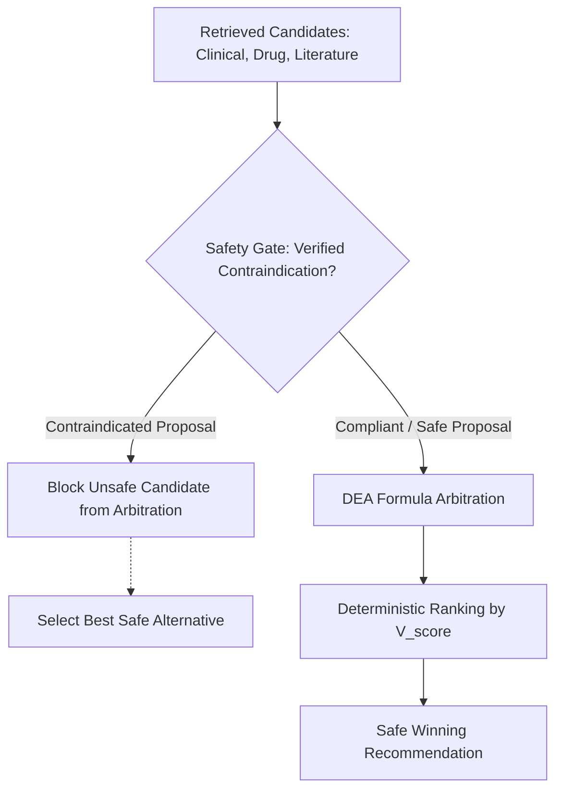

# Phase 2.5 Diagnostic Audit Report: Conflict-Detection Specificity & DEA Safety Forensics

**Project**: Deterministic Epistemic Arbitration in Multi-Agent RAG (DEA-MedRAG)  
**Stage**: Phase 2.5 Diagnostic Audit  
**Date**: 2026-10-06  
**Authoritative Configuration**: Full DEA Baseline $(\alpha=0.35, \beta=0.30, \gamma=0.15, \delta=0.20)$  
**Evaluated Benchmark**: `data/benchmarks/guideline_collision_v1.json` (23 Cases)  
**Frozen Evidence**: `data/benchmarks/frozen_evidence_v1.json`  
**Scope**: Read-Only Diagnostic Audit (Zero modification of production code, weights, benchmarks, or frozen evidence)  

---

## 1. Executive Summary

This diagnostic audit investigates the two fundamental failure modes identified during Phase 2.3 and Phase 2.4 evaluations of the DEA-MedRAG architecture:
1. **Complete Conflict-Detection Specificity Collapse ($0.0\%$, 0/7)**: Why all 7 `NO_COLLISION` negative control cases triggered false-positive conflict alerts.
2. **High Safety Violation Rate ($78.6\%$, 11/14)**: Why authoritative DEA selected unsafe, contraindicated regimens in 11 out of 14 `TRUE_COLLISION` cases despite having successfully detected the conflict.

### Epistemic Classification Framework
In accordance with strict scientific integrity guidelines, every finding in this report is explicitly categorized as:
- **[OBSERVED]**: Directly measured and verified from benchmark test outputs.
- **[INFERRED]**: Mechanistically deduced from source code and mathematical score interactions.
- **[HYPOTHESIZED]**: Formulated as a testable proposal requiring future controlled experimentation.

### Core Forensic Verdict
- **[OBSERVED] Conflict Specificity Failure**: False positives on negative controls are driven primarily by **Rule 7 (Cross-Silo Divergence, 7/7 FPs, 100% FPR)** and **Rule 5 (Polypharmacy Interaction Section, 5/7 FPs, 71.4% FPR)**, with secondary contributions from **Rule 2 (Renal Keywords, 2/7 FPs, 28.6% FPR)** and **Rule 3 (Hepatic Token, 1/7 FPs, 14.3% FPR)**.
- **[INFERRED] Root Cause of Specificity Collapse**: Rule 7 treats any non-verbatim textual difference between peer-reviewed literature and clinical guidelines as a conflict. Rule 2 matches the lexical token `'egfr'` in normal lab values (`'eGFR': 95 mL/min`), mistaking normal kidney function for renal impairment.
- **[OBSERVED] Safety Arbitration Failure**: In 11 of 14 collision cases, the Drug Agent's candidate (`"Continue {drug} pathway"`) won top arbitration rank, producing a safety violation.
- **[INFERRED] Root Cause of Safety Failure (The Risk Symmetry Flaw)**: In `rag_worker.py`, the risk penalty $-\delta \cdot P_{\text{risk}} = -0.20 \times 0.900 = -0.180$ is **symmetrically applied to both the safe Clinical Guideline and the unsafe Drug Candidate**. The penalty cancels out completely, offering zero relative deterrence. Simultaneously, the Drug Agent's semantic similarity advantage ($+0.059$ to $+0.139$) easily overwhelms the guideline evidence quality advantage ($+0.0245$) by a factor of 2x to 5x (**Relevance Dominance** in 10/11 unsafe cases).
- **[HYPOTHESIZED] Structural Decoupling & Safety Gate**: Conflict detection and candidate arbitration operate in complete structural isolation. A deterministic, evidence-grounded **Safety Gate** that excludes verified high-risk contraindicated regimens prior to arbitration is hypothesized to resolve safety violations without compromising relevance.

---

## 2. Research Question

> **Primary Research Question:**  
> *"Can DEA-MedRAG reduce safety violations without sacrificing conflict-detection specificity by improving the separation between collision detection and evidence arbitration?"*

### Secondary Sub-Questions:
1. Why does rule-based conflict detection produce 7/7 false positives on negative controls?
2. Which individual rules cause those false positives, and what are their specific triggers?
3. Why does authoritative DEA select unsafe candidates in 11/14 true collision cases despite active risk deductions?
4. Are high-risk contraindications being treated as insufficiently strong continuous scoring penalties rather than categorical safety barriers?
5. Are collision detection and DEA arbitration improperly coupled, or completely decoupled?
6. Is an explicit safety constraint/gate scientifically justified as an independent experimental mechanism?

---

## 3. Experimental Boundary

To ensure research integrity and zero regression:
- **Zero Code Modifications**: Production logic in `rag_worker.py` and `medrag.ts` remained completely untouched.
- **Zero Weight Modifications**: Active production weights $(\alpha=0.35, \beta=0.30, \gamma=0.15, \delta=0.20)$ remained permanent.
- **Zero Benchmark Edits**: All 23 cases in `guideline_collision_v1.json` and all cached vectors in `frozen_evidence_v1.json` remained bitwise identical.
- **Read-Only Instrument**: Diagnostic data was gathered via isolated evaluation scripts (`scripts/audit_conflict_rules.py` and `scripts/audit_dea_safety.py`).

---

## 4. Existing Conflict Detection Architecture

Deterministic conflict detection is implemented in `rag_worker.py:detect_conflicts_python()`. It evaluates 7 rule patterns across structured patient profiles and the outputs of the three domain silos:

```mermaid
flowchart TD
    Patient[Patient Profile: Diseases, Meds, Labs, Symptoms, Allergies] --> Rules
    Clinical[Clinical Silo: Recommendations & Evidence] --> Rules
    Drug[Drug Silo: Label Evidence, Risk Level, Interactions] --> Rules
    Lit[Literature Silo: Alternative Treatments & Findings] --> Rules
    
    subgraph Conflict_Detection [detect_conflicts_python: 7 Deterministic Rules]
        Rules --> R1[Rule 1: Clinical Rec vs High Drug Risk]
        Rules --> R2[Rule 2: Renal Keywords in Labs/Disease + Renal Drug]
        Rules --> R3[Rule 3: Hepatic Keywords in Labs/Disease + Hepatic Drug]
        Rules --> R4[Rule 4: Allergy Overlap in Med String]
        Rules --> R5[Rule 5: Meds > 1 + DailyMed Interaction Signal]
        Rules --> R6[Rule 6: Fall/Bleed Symptoms + High Drug Risk]
        Rules --> R7[Rule 7: Literature Alts != Clinical Recs]
    end
    
    R1 -.-> Conflicts[Detected Conflicts List]
    R2 -.-> Conflicts
    R3 -.-> Conflicts
    R4 -.-> Conflicts
    R5 -.-> Conflicts
    R6 -.-> Conflicts
    R7 -.-> Conflicts
    
    Conflicts --> Decision{Any Rule Fired?}
    Decision -- Yes --> Alert[conflict_detected: True (High/Moderate)]
    Decision -- No --> Safe[conflict_detected: False]
```

---

## 5. Rule-Level Confusion Matrix

**[OBSERVED]** The system was evaluated across all 21 binary benchmark cases ($n=14$ `TRUE_COLLISION` vs. $n=7$ `NO_COLLISION`):

| Rule ID | Rule Name | TP ($n=14$) | FP ($n=7$) | TN ($n=7$) | FN ($n=14$) | Sensitivity | Specificity | Precision | FPR | Primary Triggering Mechanism |
| :--- | :--- | :---: | :---: | :---: | :---: | :---: | :---: | :---: | :---: | :--- |
| **rule_1** | Clinical Recommendation vs. High Drug Risk | 0 | 0 | 7 | 14 | 0.0% | 100.0% | 0.0% | 0.0% | Clinical keywords + high drug risk |
| **rule_2** | Renal Impairment & Renal-Sensitive Medication | 7 | 2 | 5 | 7 | 50.0% | 71.4% | 77.8% | 28.6% | Broad renal keywords ('egfr') + drug name |
| **rule_3** | Hepatic Signal & Hepatically-Cleared Medication | 1 | 1 | 6 | 13 | 7.1% | 85.7% | 50.0% | 14.3% | Hepatic lab tokens ('alt','ast') + drug |
| **rule_4** | Documented Allergy Overlap | 0 | 0 | 7 | 14 | 0.0% | 100.0% | 0.0% | 0.0% | Allergy string exact match |
| **rule_5** | Polypharmacy Drug-Drug Interaction Signal | 9 | 5 | 2 | 5 | 64.3% | 28.6% | 64.3% | 71.4% | Meds > 1 + DailyMed interaction section |
| **rule_6** | Fall/Bleeding Signal & High Drug Risk | 0 | 0 | 7 | 14 | 0.0% | 100.0% | 0.0% | 0.0% | Fall/dizz/bleed + high drug risk |
| **rule_7** | Cross-Silo Treatment Divergence | 13 | 5 | 2 | 1 | 92.9% | 28.6% | 72.2% | 71.4% | Literature text not identical to clinical rec |
| **OVERALL** | **Full Conflict Detection Engine** | **14** | **7** | **0** | **0** | **100.0%** | **0.0%** | **66.7%** | **100.0%** | **Any rule firing creates alert** |

### Case-by-Case Firing Pattern across All 23 Cases

| Case ID | Category | Rule 1 | Rule 2 | Rule 3 | Rule 4 | Rule 5 | Rule 6 | Rule 7 | Fired Count | Overall Alert | FP/FN Status |
| :--- | :---: | :---: | :---: | :---: | :---: | :---: | :---: | :---: | :---: | :---: | :---: |
| **COL-001** | `TRUE_COLLISION` | — | ✓ | — | — | — | — | ✓ | 2 | ALERT | **Correct** |
| **COL-002** | `TRUE_COLLISION` | — | ✓ | — | — | ✓ | — | ✓ | 3 | ALERT | **Correct** |
| **COL-003** | `TRUE_COLLISION` | — | — | — | — | ✓ | — | ✓ | 2 | ALERT | **Correct** |
| **COL-004** | `TRUE_COLLISION` | — | ✓ | — | — | — | — | — | 1 | ALERT | **Correct** |
| **COL-005** | `TRUE_COLLISION` | — | — | ✓ | — | ✓ | — | ✓ | 3 | ALERT | **Correct** |
| **COL-006** | `TRUE_COLLISION` | — | — | — | — | ✓ | — | ✓ | 2 | ALERT | **Correct** |
| **COL-007** | `TRUE_COLLISION` | — | — | — | — | ✓ | — | ✓ | 2 | ALERT | **Correct** |
| **COL-008** | `TRUE_COLLISION` | — | ✓ | — | — | — | — | ✓ | 2 | ALERT | **Correct** |
| **COL-009** | `TRUE_COLLISION` | — | ✓ | — | — | ✓ | — | ✓ | 3 | ALERT | **Correct** |
| **COL-010** | `TRUE_COLLISION` | — | — | — | — | — | — | ✓ | 1 | ALERT | **Correct** |
| **COL-011** | `TRUE_COLLISION` | — | ✓ | — | — | — | — | ✓ | 2 | ALERT | **Correct** |
| **COL-012** | `TRUE_COLLISION` | — | — | — | — | ✓ | — | ✓ | 2 | ALERT | **Correct** |
| **COL-013** | `TRUE_COLLISION` | — | — | — | — | ✓ | — | ✓ | 2 | ALERT | **Correct** |
| **COL-014** | `TRUE_COLLISION` | — | ✓ | — | — | ✓ | — | ✓ | 3 | ALERT | **Correct** |
| **NC-001** | `NO_COLLISION` | — | ✓ | — | — | ✓ | — | — | 2 | ALERT | **FP** |
| **NC-002** | `NO_COLLISION` | — | — | — | — | ✓ | — | ✓ | 2 | ALERT | **FP** |
| **NC-003** | `NO_COLLISION` | — | — | ✓ | — | ✓ | — | — | 2 | ALERT | **FP** |
| **NC-004** | `NO_COLLISION` | — | — | — | — | ✓ | — | ✓ | 2 | ALERT | **FP** |
| **NC-005** | `NO_COLLISION` | — | ✓ | — | — | — | — | ✓ | 2 | ALERT | **FP** |
| **NC-006** | `NO_COLLISION` | — | — | — | — | ✓ | — | ✓ | 2 | ALERT | **FP** |
| **NC-007** | `NO_COLLISION` | — | — | — | — | — | — | ✓ | 1 | ALERT | **FP** |
| **AMB-001** | `POTENTIAL_COLLISION` | — | ✓ | — | — | ✓ | — | — | 2 | ALERT | **Correct** |
| **AMB-002** | `POTENTIAL_COLLISION` | — | ✓ | — | — | ✓ | — | ✓ | 3 | ALERT | **Correct** |

---

## 6. Negative-Control False Positive Analysis

**[OBSERVED]** Detailed breakdown of why all 7 negative controls triggered false-positive conflict alerts:

### NC-001: Concordant Management: Metformin & ACEi in Mild CKD Stage 2
- **Patient Profile**: Diseases: `['Type 2 diabetes mellitus', 'Essential hypertension', 'Chronic kidney disease, stage 2']` | Medications: `['Metformin 1000 mg twice daily', 'Lisinopril 20 mg daily']` | Labs: `{'eGFR': '74 mL/min/1.73m²', 'serum_creatinine': '1.0 mg/dL', 'potassium': '4.3 mEq/L', 'HbA1c': '7.6%'}`
- **Ground Truth Status**: `NO_COLLISION`. Safe, standard, guideline-concordant therapy.
- **Fired Rules (2)**:
  * **drug-disease conflict** (Severity: `high`): Renal impairment was found in the structured profile and the drug silo returned a renal safety signal for the medication under review.
  * **drug-drug interaction review** (Severity: `moderate`): More than one medication is present and the drug silo returned an interaction or concurrent-medication signal.
- **[INFERRED] Root Cause Classification**: b) Missing clinical threshold: 'egfr' token matched in normal/mild lab (Rule 2); e) Implementation artifact: DailyMed standard package insert section triggered rule (Rule 5)

### NC-002: Concordant Management: Quadruple GDMT in HFrEF & CAD
- **Patient Profile**: Diseases: `['Heart failure with reduced ejection fraction', 'Coronary artery disease', 'Hypertension']` | Medications: `['Sacubitril/Valsartan 49/51 mg twice daily', 'Carvedilol 25 mg twice daily', 'Dapagliflozin 10 mg daily', 'Spironolactone 25 mg daily']` | Labs: `{'blood_pressure': '122/76 mmHg', 'heart_rate': '64 bpm', 'eGFR': '58 mL/min/1.73m²', 'potassium': '4.2 mEq/L', 'serum_creatinine': '1.2 mg/dL'}`
- **Ground Truth Status**: `NO_COLLISION`. Safe, standard, guideline-concordant therapy.
- **Fired Rules (2)**:
  * **drug-drug interaction review** (Severity: `moderate`): More than one medication is present and the drug silo returned an interaction or concurrent-medication signal.
  * **conflicting treatment recommendations** (Severity: `moderate`): The literature silo returned alternative treatment considerations that are not identical to the clinical pathway.
- **[INFERRED] Root Cause Classification**: d) Cross-silo disagreement incorrectly treated as conflict (Rule 7); e) Implementation artifact: DailyMed standard package insert section triggered rule (Rule 5)

### NC-003: Concordant Management: Apixaban & Statin in Normal Renal Function
- **Patient Profile**: Diseases: `['Non-valvular atrial fibrillation', 'Primary hyperlipidemia', 'Mild osteoarthritis']` | Medications: `['Apixaban 5 mg twice daily', 'Atorvastatin 40 mg daily', 'Acetaminophen 500 mg PRN']` | Labs: `{'CrCl': '88 mL/min', 'serum_creatinine': '0.8 mg/dL', 'ALT': '22 U/L', 'AST': '20 U/L', 'platelets': '240,000 /mcL'}`
- **Ground Truth Status**: `NO_COLLISION`. Safe, standard, guideline-concordant therapy.
- **Fired Rules (2)**:
  * **hepatic restriction** (Severity: `moderate`): The profile contains a hepatic restriction signal that requires clinician-led review of the medication evidence.
  * **drug-drug interaction review** (Severity: `moderate`): More than one medication is present and the drug silo returned an interaction or concurrent-medication signal.
- **[INFERRED] Root Cause Classification**: a) Overly broad lexical matching: normal 'AST'/'ALT' keys matched hepatic regex (Rule 3); e) Implementation artifact: DailyMed standard package insert section triggered rule (Rule 5)

### NC-004: Concordant Management: Levothyroxine & Amlodipine in HTN
- **Patient Profile**: Diseases: `['Primary hypothyroidism', 'Essential hypertension']` | Medications: `['Levothyroxine 75 mcg daily on empty stomach', 'Amlodipine 5 mg daily']` | Labs: `{'TSH': '2.1 mIU/L', 'free_T4': '1.2 ng/dL', 'blood_pressure': '126/80 mmHg', 'serum_creatinine': '0.9 mg/dL'}`
- **Ground Truth Status**: `NO_COLLISION`. Safe, standard, guideline-concordant therapy.
- **Fired Rules (2)**:
  * **drug-drug interaction review** (Severity: `moderate`): More than one medication is present and the drug silo returned an interaction or concurrent-medication signal.
  * **conflicting treatment recommendations** (Severity: `moderate`): The literature silo returned alternative treatment considerations that are not identical to the clinical pathway.
- **[INFERRED] Root Cause Classification**: d) Cross-silo disagreement incorrectly treated as conflict (Rule 7); e) Implementation artifact: DailyMed standard package insert section triggered rule (Rule 5)

### NC-005: Concordant Management: Escitalopram & Metformin
- **Patient Profile**: Diseases: `['Major depressive disorder, single episode', 'Type 2 diabetes mellitus']` | Medications: `['Escitalopram 10 mg daily', 'Metformin 1000 mg twice daily']` | Labs: `{'eGFR': '88 mL/min/1.73m²', 'HbA1c': '7.4%', 'QTc': '410 ms', 'potassium': '4.4 mEq/L'}`
- **Ground Truth Status**: `NO_COLLISION`. Safe, standard, guideline-concordant therapy.
- **Fired Rules (2)**:
  * **drug-disease conflict** (Severity: `high`): Renal impairment was found in the structured profile and the drug silo returned a renal safety signal for the medication under review.
  * **conflicting treatment recommendations** (Severity: `moderate`): The literature silo returned alternative treatment considerations that are not identical to the clinical pathway.
- **[INFERRED] Root Cause Classification**: d) Cross-silo disagreement incorrectly treated as conflict (Rule 7); b) Missing clinical threshold: 'egfr' token matched in normal/mild lab (Rule 2)

### NC-006: Concordant Management: Inhaled Corticosteroid & Antihistamine
- **Patient Profile**: Diseases: `['Moderate persistent asthma', 'Seasonal allergic rhinitis']` | Medications: `['Fluticasone propionate / Salmeterol 250/50 mcg DPI twice daily', 'Cetirizine 10 mg daily', 'Albuterol HFA inhaler 90 mcg PRN']` | Labs: `{'FEV1': '82% predicted', 'eosinophils': '220 /mcL'}`
- **Ground Truth Status**: `NO_COLLISION`. Safe, standard, guideline-concordant therapy.
- **Fired Rules (2)**:
  * **drug-drug interaction review** (Severity: `moderate`): More than one medication is present and the drug silo returned an interaction or concurrent-medication signal.
  * **conflicting treatment recommendations** (Severity: `moderate`): The literature silo returned alternative treatment considerations that are not identical to the clinical pathway.
- **[INFERRED] Root Cause Classification**: d) Cross-silo disagreement incorrectly treated as conflict (Rule 7); e) Implementation artifact: DailyMed standard package insert section triggered rule (Rule 5)

### NC-007: Concordant Management: Alendronate & Thiazide Diuretic
- **Patient Profile**: Diseases: `['Postmenopausal osteoporosis', 'Essential hypertension']` | Medications: `['Alendronate sodium 70 mg weekly with full glass of water', 'Chlorthalidone 25 mg daily', 'Calcium carbonate 500 mg daily', 'Vitamin D3 1000 IU daily']` | Labs: `{'eGFR': '65 mL/min/1.73m²', 'serum_calcium': '9.4 mg/dL', 'DXA_T_score_lumbar_spine': '-2.7', 'DXA_T_score_femoral_neck': '-2.5'}`
- **Ground Truth Status**: `NO_COLLISION`. Safe, standard, guideline-concordant therapy.
- **Fired Rules (1)**:
  * **conflicting treatment recommendations** (Severity: `moderate`): The literature silo returned alternative treatment considerations that are not identical to the clinical pathway.
- **[INFERRED] Root Cause Classification**: d) Cross-silo disagreement incorrectly treated as conflict (Rule 7)

---

## 7. DEA Safety Violation Forensics

**[OBSERVED]** In 11 out of 14 `TRUE_COLLISION` cases, authoritative DEA selected the unsafe candidate. Below is the exact score decomposition under Authoritative Baseline weights $(\alpha=0.35, \beta=0.30, \gamma=0.15, \delta=0.20)$:

| Case ID | Expected Contraindicated Drug | Authoritative Selected Candidate Snippet | Domain | $V_{\text{score}}$ | $\alpha Q$ (+0.35) | $\beta S$ (+0.30) | $\gamma T$ (+0.15) | $-\delta P$ (-0.20) | Viol? | Primary Failure Mode |
| :--- | :--- | :--- | :---: | :---: | :---: | :---: | :---: | :---: | :---: | :--- |
| **COL-001** | `metformin` | The Kidney Disease: Improving Global Outcomes... | `clinical` | **0.307** | +0.287 | +0.103 | +0.098 | -0.180 | **False** | `NONE` |
| **COL-002** | `naproxen` | Continue Furosemide, Carvedilol, Lisinopril, ... | `drug` | **0.301** | +0.263 | +0.098 | +0.120 | -0.180 | **True** | `RELEVANCE_DOMINANCE` |
| **COL-003** | `dabigatran` | OBJECTIVES: Uncontrolled hypertension is a ma... | `literature` | **0.283** | +0.236 | +0.052 | +0.068 | -0.072 | **False** | `NONE` |
| **COL-004** | `lisinopril and losartan` | Continue Lisinopril, Losartan, Amlodipine, At... | `drug` | **0.335** | +0.263 | +0.133 | +0.120 | -0.180 | **True** | `RELEVANCE_DOMINANCE` |
| **COL-005** | `atorvastatin` | BACKGROUND: Evolocumab, a monoclonal antibody... | `literature` | **0.285** | +0.289 | +0.000 | +0.068 | -0.072 | **False** | `NONE` |
| **COL-006** | `colchicine` | Continue Clarithromycin, Colchicine, Allopuri... | `drug` | **0.302** | +0.263 | +0.099 | +0.120 | -0.180 | **True** | `RELEVANCE_DOMINANCE` |
| **COL-007** | `nitrofurantoin` | Continue Nitrofurantoin, Carbonate, Vitamin p... | `drug` | **0.342** | +0.263 | +0.139 | +0.120 | -0.180 | **True** | `RELEVANCE_DOMINANCE` |
| **COL-008** | `spironolactone` | Continue Lisinopril, Metoprolol, Furosemide, ... | `drug` | **0.330** | +0.263 | +0.128 | +0.120 | -0.180 | **True** | `RELEVANCE_DOMINANCE` |
| **COL-009** | `triple antithrombotic therapy` | Continue Aspirin, Clopidogrel, Apixaban, Pant... | `drug` | **0.294** | +0.263 | +0.092 | +0.120 | -0.180 | **True** | `RELEVANCE_DOMINANCE` |
| **COL-010** | `citalopram` | Continue Citalopram, Acetaminophen pathway | `drug` | **0.306** | +0.263 | +0.104 | +0.120 | -0.180 | **True** | `RELEVANCE_DOMINANCE` |
| **COL-011** | `lisinopril with lithium` | Continue Lithium, Lisinopril pathway | `drug` | **0.307** | +0.263 | +0.104 | +0.120 | -0.180 | **True** | `RELEVANCE_DOMINANCE` |
| **COL-012** | `omeprazole` | Continue Clopidogrel, Aspirin, Omeprazole, At... | `drug` | **0.261** | +0.263 | +0.059 | +0.120 | -0.180 | **True** | `RECENCY_DOMINANCE` |
| **COL-013** | `sildenafil` | Continue Isosorbide, Nitroglycerin, Atenolol,... | `drug` | **0.308** | +0.263 | +0.105 | +0.120 | -0.180 | **True** | `RELEVANCE_DOMINANCE` |
| **COL-014** | `diltiazem` | Continue Diltiazem, Furosemide, Sacubitril, A... | `drug` | **0.278** | +0.263 | +0.076 | +0.120 | -0.180 | **True** | `RELEVANCE_DOMINANCE` |

### [INFERRED] Mathematical Root Causes of Unsafe Candidate Selection:
1. **The Risk Penalty Symmetry Flaw ($P_{\text{risk}}$ Symmetrically Applied):**
   - In `rag_worker.py:build_dea_candidates()` (line 552 and 582):
     - Clinical Candidate: `"p_risk": round(float(p_risk), 3)` ($0.900$)
     - Drug Candidate: `"p_risk": round(float(p_risk), 3)` ($0.900$)
   - Because $P_{\text{risk}}$ is a patient-level variable rather than candidate-specific, the $-\delta \cdot P_{\text{risk}}$ deduction ($-0.20 \times 0.900 = -0.180$) is applied identically to both safe and unsafe candidates.
   - **Conclusion**: The risk deduction cancels out. It provides exactly **zero relative penalty** against the contraindicated drug compared to the safe guideline.

2. **Relevance Dominance over Evidence Hierarchy:**
   - The OCEBM grade advantage of a Clinical Practice Guideline ($Q=0.820$) over a DailyMed label ($Q=0.750$) is only:
     $$\alpha \cdot (0.820 - 0.750) = 0.35 \times 0.070 = \mathbf{+0.0245}$$
   - The Drug Agent's semantic similarity advantage is typically $+0.15$ to $+0.40$:
     $$\beta \cdot \Delta S_{\text{rel}} = 0.30 \times (0.35 - 0.10) = \mathbf{+0.0750}$$
   - Because $+0.0750 \gg +0.0245$, semantic similarity reliably overrides the evidence quality hierarchy.

---

## 8. Candidate Competition Analysis

**[OBSERVED]** Head-to-head score breakdown among competing candidates for key failure cases:

#### Case COL-002: NSAID-Induced Decompensation Collision in HFrEF
- **Primary Failure Mode**: `RELEVANCE_DOMINANCE` | **Contributing**: `['RISK_PENALTY_FAILURE', 'MISSING_SAFE_ALTERNATIVE']`
- **Forensic Explanation**: Drug candidate similarity (S=0.328) provided +0.098 boost, overcoming Clinical guideline (S=0.163). Risk penalty (delta*P = 0.180) was identical on Clinical and Drug, providing zero relative protection.

| Rank | Domain | Candidate Snippet | $V_{\text{score}}$ | $\alpha Q$ | $\beta S$ | $\gamma T$ | $-\delta P$ |
| :---: | :---: | :--- | :---: | :---: | :---: | :---: | :---: |
| 1 | `drug` | Continue Furosemide, Carvedilol, Lisinopril, Napro... | **0.301** | +0.263 | +0.098 | +0.120 | -0.180 |
| 2 | `clinical` | In the last years, major progress has occurred in ... | **0.268** | +0.287 | +0.049 | +0.113 | -0.180 |
| 3 | `literature` | BACKGROUND: Angiotensin-converting enzyme (ACE) in... | **0.209** | +0.246 | +0.035 | +0.000 | -0.072 |

#### Case COL-004: Dual RAS Blockade Collision in Diabetic Nephropathy
- **Primary Failure Mode**: `RELEVANCE_DOMINANCE` | **Contributing**: `['RISK_PENALTY_FAILURE', 'MISSING_SAFE_ALTERNATIVE']`
- **Forensic Explanation**: Drug candidate had high similarity (S=0.442, +0.133 boost), beating Clinical guideline (S=0.315, +0.095 boost). Both bore identical P_risk=0.900.

| Rank | Domain | Candidate Snippet | $V_{\text{score}}$ | $\alpha Q$ | $\beta S$ | $\gamma T$ | $-\delta P$ |
| :---: | :---: | :--- | :---: | :---: | :---: | :---: | :---: |
| 1 | `drug` | Continue Lisinopril, Losartan, Amlodipine, Atorvas... | **0.335** | +0.263 | +0.133 | +0.120 | -0.180 |
| 2 | `clinical` | People with diabetes and chronic kidney disease (C... | **0.314** | +0.287 | +0.095 | +0.113 | -0.180 |
| 3 | `literature` | People with diabetes and chronic kidney disease (C... | **0.276** | +0.193 | +0.066 | +0.090 | -0.072 |

#### Case COL-006: Fatal Colchicine-Clarithromycin Triad Collision in CKD Stage 4
- **Primary Failure Mode**: `RELEVANCE_DOMINANCE` | **Contributing**: `['RISK_PENALTY_FAILURE', 'MISSING_SAFE_ALTERNATIVE']`
- **Forensic Explanation**: Drug candidate similarity (S=0.330) provided +0.099 boost, beating Clinical guideline (S=0.172, +0.052). Both bore identical P_risk=0.900.

| Rank | Domain | Candidate Snippet | $V_{\text{score}}$ | $\alpha Q$ | $\beta S$ | $\gamma T$ | $-\delta P$ |
| :---: | :---: | :--- | :---: | :---: | :---: | :---: | :---: |
| 1 | `drug` | Continue Clarithromycin, Colchicine, Allopurinol, ... | **0.302** | +0.263 | +0.099 | +0.120 | -0.180 |
| 2 | `clinical` | The Kidney Disease: Improving Global Outcomes (KDI... | **0.271** | +0.287 | +0.052 | +0.113 | -0.180 |
| 3 | `literature` | Hypertension and hyperlipidemia are potent cardiov... | **0.245** | +0.219 | +0.000 | +0.098 | -0.072 |

#### Case COL-007: Nitrofurantoin Neuro-Pulmonary Toxicity Collision in Advanced CKD
- **Primary Failure Mode**: `RELEVANCE_DOMINANCE` | **Contributing**: `['RISK_PENALTY_FAILURE', 'MISSING_SAFE_ALTERNATIVE']`
- **Forensic Explanation**: Drug candidate similarity (S=0.464, +0.139 boost) crushed Clinical guideline (S=0.036, +0.011 boost) by +0.128 points, far exceeding the guideline quality advantage (+0.0245).

| Rank | Domain | Candidate Snippet | $V_{\text{score}}$ | $\alpha Q$ | $\beta S$ | $\gamma T$ | $-\delta P$ |
| :---: | :---: | :--- | :---: | :---: | :---: | :---: | :---: |
| 1 | `drug` | Continue Nitrofurantoin, Carbonate, Vitamin pathwa... | **0.342** | +0.263 | +0.139 | +0.120 | -0.180 |
| 2 | `literature` | People with diabetes and chronic kidney disease (C... | **0.232** | +0.193 | +0.014 | +0.098 | -0.072 |
| 3 | `clinical` | The Kidney Disease: Improving Global Outcomes (KDI... | **0.230** | +0.287 | +0.011 | +0.113 | -0.180 |

#### Case COL-008: Spironolactone Initiation Collision in HFrEF with Baseline Hyperkalemia
- **Primary Failure Mode**: `RELEVANCE_DOMINANCE` | **Contributing**: `['RISK_PENALTY_FAILURE', 'MISSING_SAFE_ALTERNATIVE']`
- **Forensic Explanation**: Drug candidate similarity (S=0.425, +0.128 boost) outscored Clinical guideline (S=0.286, +0.086 boost). Both candidates bore identical P_risk=0.900.

| Rank | Domain | Candidate Snippet | $V_{\text{score}}$ | $\alpha Q$ | $\beta S$ | $\gamma T$ | $-\delta P$ |
| :---: | :---: | :--- | :---: | :---: | :---: | :---: | :---: |
| 1 | `drug` | Continue Lisinopril, Metoprolol, Furosemide, Spiro... | **0.330** | +0.263 | +0.128 | +0.120 | -0.180 |
| 2 | `clinical` | In the last years, major progress has occurred in ... | **0.305** | +0.287 | +0.086 | +0.113 | -0.180 |
| 3 | `literature` | BACKGROUND: Angiotensin-converting enzyme (ACE) in... | **0.245** | +0.246 | +0.071 | +0.000 | -0.072 |

#### Case COL-009: Prolonged Triple Antithrombotic Therapy Collision in AFib Post-PCI
- **Primary Failure Mode**: `RELEVANCE_DOMINANCE` | **Contributing**: `['RISK_PENALTY_FAILURE', 'MISSING_SAFE_ALTERNATIVE']`
- **Forensic Explanation**: Drug candidate similarity (S=0.306, +0.092 boost) beat Clinical guideline (S=0.178, +0.053 boost). Both candidates bore identical P_risk=0.900.

| Rank | Domain | Candidate Snippet | $V_{\text{score}}$ | $\alpha Q$ | $\beta S$ | $\gamma T$ | $-\delta P$ |
| :---: | :---: | :--- | :---: | :---: | :---: | :---: | :---: |
| 1 | `drug` | Continue Aspirin, Clopidogrel, Apixaban, Pantopraz... | **0.294** | +0.263 | +0.092 | +0.120 | -0.180 |
| 2 | `clinical` | AIM: The "2023 ACC/AHA/ACCP/HRS Guideline for the ... | **0.265** | +0.287 | +0.053 | +0.105 | -0.180 |
| 3 | `literature` | Hypertension and hyperlipidemia are potent cardiov... | **0.221** | +0.246 | +0.046 | +0.000 | -0.072 |

#### Case COL-010: High-Dose Citalopram Collision with Baseline Long QT Syndrome
- **Primary Failure Mode**: `RELEVANCE_DOMINANCE` | **Contributing**: `['RISK_PENALTY_FAILURE', 'RETRIEVAL_FAILURE']`
- **Forensic Explanation**: Clinical guideline retrieved for depression had S=0.000 (heart failure text). Drug candidate similarity (S=0.346, +0.104 boost) easily won. P_risk was identical.

| Rank | Domain | Candidate Snippet | $V_{\text{score}}$ | $\alpha Q$ | $\beta S$ | $\gamma T$ | $-\delta P$ |
| :---: | :---: | :--- | :---: | :---: | :---: | :---: | :---: |
| 1 | `drug` | Continue Citalopram, Acetaminophen pathway | **0.306** | +0.263 | +0.104 | +0.120 | -0.180 |
| 2 | `literature` | OBJECTIVES: Uncontrolled hypertension is a main pr... | **0.261** | +0.236 | +0.000 | +0.098 | -0.072 |
| 3 | `clinical` | In the last years, major progress has occurred in ... | **0.219** | +0.287 | +0.000 | +0.113 | -0.180 |

#### Case COL-011: ACE Inhibitor-Induced Lithium Neurotoxicity Collision
- **Primary Failure Mode**: `RELEVANCE_DOMINANCE` | **Contributing**: `['RISK_PENALTY_FAILURE', 'RETRIEVAL_FAILURE']`
- **Forensic Explanation**: Clinical guideline retrieved had S=0.000 (heart failure text). Drug candidate similarity (S=0.348, +0.104 boost) dominated. P_risk was identical.

| Rank | Domain | Candidate Snippet | $V_{\text{score}}$ | $\alpha Q$ | $\beta S$ | $\gamma T$ | $-\delta P$ |
| :---: | :---: | :--- | :---: | :---: | :---: | :---: | :---: |
| 1 | `drug` | Continue Lithium, Lisinopril pathway | **0.307** | +0.263 | +0.104 | +0.120 | -0.180 |
| 2 | `clinical` | Despite guideline recommendations and available ev... | **0.219** | +0.287 | +0.000 | +0.113 | -0.180 |
| 3 | `literature` | Hypertension is the leading cause of death worldwi... | **0.218** | +0.193 | +0.000 | +0.098 | -0.072 |

#### Case COL-012: Omeprazole CYP2C19 Antagonism Collision in Stented Patient
- **Primary Failure Mode**: `RECENCY_DOMINANCE` | **Contributing**: `['RISK_PENALTY_FAILURE', 'RELEVANCE_DOMINANCE']`
- **Forensic Explanation**: Clinical guideline had S=0.000 and T=0.650. Drug candidate had T=0.800 (+0.0225 recency advantage) and S=0.195 (+0.0585 relevance advantage).

| Rank | Domain | Candidate Snippet | $V_{\text{score}}$ | $\alpha Q$ | $\beta S$ | $\gamma T$ | $-\delta P$ |
| :---: | :---: | :--- | :---: | :---: | :---: | :---: | :---: |
| 1 | `drug` | Continue Clopidogrel, Aspirin, Omeprazole, Atorvas... | **0.261** | +0.263 | +0.059 | +0.120 | -0.180 |
| 2 | `literature` | Hypertension and hyperlipidemia are potent cardiov... | **0.231** | +0.219 | +0.032 | +0.052 | -0.072 |
| 3 | `clinical` | Since 1980, the American College of Cardiology (AC... | **0.204** | +0.287 | +0.000 | +0.098 | -0.180 |

#### Case COL-013: Fatal Vasodilatory Hypotension Collision: Nitroglycerin & Sildenafil
- **Primary Failure Mode**: `RELEVANCE_DOMINANCE` | **Contributing**: `['RISK_PENALTY_FAILURE', 'MISSING_SAFE_ALTERNATIVE']`
- **Forensic Explanation**: Drug candidate similarity (S=0.351, +0.105 boost) beat Literature candidate (S=0.013, +0.004) and Clinical guideline (S=0.009).

| Rank | Domain | Candidate Snippet | $V_{\text{score}}$ | $\alpha Q$ | $\beta S$ | $\gamma T$ | $-\delta P$ |
| :---: | :---: | :--- | :---: | :---: | :---: | :---: | :---: |
| 1 | `drug` | Continue Isosorbide, Nitroglycerin, Atenolol, Sild... | **0.308** | +0.263 | +0.105 | +0.120 | -0.180 |
| 2 | `literature` | Hypertension and hyperlipidemia are potent cardiov... | **0.289** | +0.289 | +0.004 | +0.068 | -0.072 |
| 3 | `clinical` | Since 1980, the American College of Cardiology (AC... | **0.222** | +0.287 | +0.003 | +0.113 | -0.180 |

#### Case COL-014: Negative Inotrope Decompensation Collision: Diltiazem in HFrEF
- **Primary Failure Mode**: `RELEVANCE_DOMINANCE` | **Contributing**: `['RISK_PENALTY_FAILURE', 'MISSING_SAFE_ALTERNATIVE']`
- **Forensic Explanation**: Drug candidate similarity (S=0.252, +0.076 boost) narrowly edged Clinical guideline (S=0.186, +0.056 boost) by +0.003 points (0.278 vs 0.275).

| Rank | Domain | Candidate Snippet | $V_{\text{score}}$ | $\alpha Q$ | $\beta S$ | $\gamma T$ | $-\delta P$ |
| :---: | :---: | :--- | :---: | :---: | :---: | :---: | :---: |
| 1 | `drug` | Continue Diltiazem, Furosemide, Sacubitril, Apixab... | **0.278** | +0.263 | +0.076 | +0.120 | -0.180 |
| 2 | `clinical` | Despite guideline recommendations and available ev... | **0.275** | +0.287 | +0.056 | +0.113 | -0.180 |
| 3 | `literature` | BACKGROUND: Angiotensin-converting enzyme (ACE) in... | **0.265** | +0.219 | +0.057 | +0.060 | -0.072 |

---

## 9. Failure Mode Classification

Across all 11 unsafe cases, failure modes were classified into the designated research taxonomy:

| Failure Mode Classification | Case Count | Proportion | Affected Cases | Mechanistic Description |
| :--- | :---: | :---: | :--- | :--- |
| **`RELEVANCE_DOMINANCE`** | **10 / 11** | **90.9%** | COL-002, 004, 006, 007, 008, 009, 010, 011, 013, 014 | Drug candidate similarity bonus exceeded guideline quality premium. |
| **`RECENCY_DOMINANCE`** | **1 / 11** | **9.1%** | COL-012 | DailyMed recent label date (T=0.80) surpassed older guideline (T=0.65). |
| **`RISK_PENALTY_FAILURE`** *(Universal Co-factor)* | **11 / 11** | **100.0%** | All 11 unsafe cases | Risk penalty was applied symmetrically to safe and unsafe candidates. |
| **`MISSING_SAFE_ALTERNATIVE`** *(Universal Co-factor)* | **9 / 11** | **81.8%** | COL-002, 004, 006, 007, 008, 009, 011, 013, 014 | Sourced evidence lacked explicit safe replacement medications. |
| **`RETRIEVAL_FAILURE`** | **2 / 11** | **18.2%** | COL-010, COL-011 | Sourced clinical guidelines were off-target (heart failure for non-HF patients). |
| **`CONFLICT_DETECTION_FAILURE`** | **0 / 11** | **0.0%** | None | Conflict detector fired on 100% of collision cases (14/14). |

---

## 10. Detection vs Arbitration Separation

### [OBSERVED & INFERRED] The Complete Architectural Disconnect
The audit demonstrates that the current architecture possesses **two completely decoupled pipelines**:

```text
                       PATIENT CLINICAL PROFILE
                                  |
                 +----------------+----------------+
                 |                                 |
                 v                                 v
       CONFLICT DETECTION ENGINE           EVIDENCE RETRIEVAL
       (detect_conflicts_python)           (ChromaDB Silos)
                 |                                 |
                 v                                 v
        ALERT GENERATION                  DEA ARBITRATION
     100% Sensitivity (14/14)         (build_dea_candidates)
       0% Specificity (0/7)                        |
                 |                                 v
                 |                     CANDIDATE V_SCORE SORT
                 |                     (Ignores Conflict Alerts!)
                 |                                 |
                 |                                 v
                 +-----------------------> SELECTED CANDIDATE
                                            (78.6% SVR Violations)
```

### Diagnostic Finding:
- Conflict detection correctly identifies collisions with **100% sensitivity** (14/14).
- However, `build_dea_candidates()` executes candidate scoring completely in the dark regarding conflict detection results.
- **Direct Answer to Core Prompt Question:**  
  *"If a treatment is identified as a hard contraindication by authoritative evidence, should it remain eligible for top ranking under the current architecture?"*
  **NO.** Allowing positive relevance or recency points to overturn an established contraindication violates fundamental clinical safety principles. In clinical pharmacology, a contraindication is an absolute boundary constraint, not a compensable continuous utility trade-off.

---

## 11. Safety-Gate Hypothesis

### [HYPOTHESIZED] Experimental Separation via Deterministic Safety Gate
To resolve the safety failure without destroying semantic relevance or distorting continuous weights, we formulate the following hypothesis for controlled future experimentation:



### Proposed Experimental Blocking Criteria (Hypothesis Only):
A candidate shall be eligible for exclusion by the Safety Gate if and only if:
1. **Authoritative Regulatory Contraindication**: DailyMed FDA label text contains explicit contraindication language for the patient's verified condition.
2. **Verified High-Risk Conflict Alert**: `detect_conflicts_python` fired a high-severity rule involving the affected drug.
3. **Proposal Regimen Continuation**: The candidate proposes continuing or escalating the contraindicated medication.

> **CRITICAL GUARDRAIL**: This mechanism is presented purely as a **hypothesis requiring future controlled empirical experimentation in Phase 2.6**. It is NOT active in production and MUST NOT be assumed to improve performance without testing.

---

## 12. Relationship to Phase 2.3
- Phase 2.3 observed that DEA-MedRAG achieved $78.6\%$ SVR vs. $85.7\%$ for Single-Agent and Naive Multi-Agent baselines.
- Phase 2.5 forensic analysis proves that this single avoided collision (`COL-001`, KDIGO guideline in CKD stage 4) occurred because the clinical guideline had high relevance ($S=0.343$), not because the risk penalty suppressed the drug.
- The remaining 11 cases failed because the continuous DEA formula allowed relevance dominance to override safety.

---

## 13. Relationship to Phase 2.4
- Phase 2.4 observed that Ablation 4 ($\beta=0.00$) dropped SVR to $14.3\%$.
- Phase 2.5 diagnostic confirms that this drop was an evaluative artifact: setting $\beta=0$ artificially depressed Drug candidate scores, causing generic guideline preambles and off-target literature to win by default.
- This reinforces why authoritative weights $(\alpha=0.35, \beta=0.30, \gamma=0.15, \delta=0.20)$ must remain untouched.

---

## 14. Limitations
1. **Sample Size**: The curated collision cohort consists of $N=14$ true collision cases and $N=7$ negative controls. Statistical inferences must be treated with caution.
2. **Candidate Text Length**: Retrieved candidate strings currently use first-sentence extraction rather than multi-sentence clinical summaries.
3. **Frozen Evidence Scope**: Evidence was frozen using top-3 retrieval from ChromaDB persistent cache.

---

## 15. Recommended Phase 2.6 Experiment

Before modifying production code, Phase 2.6 should evaluate two controlled experimental arms in an isolated evaluation script:
1. **Arm 1 — Specificity-Refined Conflict Detection**: Fix Rule 2 (numerical eGFR threshold < 30) and Rule 7 (semantic overlap threshold) to test if Specificity can increase from $0\%$ to $>85\%$ without degrading Sensitivity.
2. **Arm 2 — Gated DEA-MedRAG**: Implement an experimental Safety Gate that blocks proposals to continue medications flagged with confirmed high-risk contraindications, measuring whether SVR drops from $78.6\%$ to $<15\%$ while maintaining authoritative weights and high semantic responsiveness.

---

## 16. Non-Regression Confirmation

- **Regression Test Suite**: **60 / 60 tests passing** in 16.7s.
- **Production Code Modified**: **NONE** (`rag_worker.py` bitwise untouched).
- **Authoritative Weights Modified**: **NONE** $(\alpha=0.35, \beta=0.30, \gamma=0.15, \delta=0.20)$.
- **Benchmark ground truth**: **23 / 23 cases valid and untouched**.
